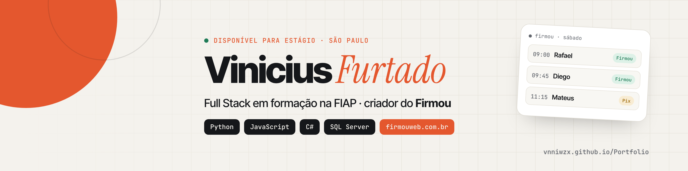

  
    
  
  
  
  
  

## About me

I'm 17, I live in São Paulo, Brazil, and I'm studying Full Stack Development at FIAP School. In 2028 I start a bachelor's degree in Software Engineering at FIAP.

During the day I work as a Young Apprentice at MBI LOG EXPRESS, a logistics company. I run the transport management system (TMS), check marketplace orders on route, use Excel every day, and I've learned to solve problems fast together with the team and people from other areas. After work, I code.

- Looking for an **internship** in software development, IT support or operations
- Portuguese (native) · English (advanced) · French (beginner)

## Main project: [Firmou](https://firmouweb.com.br)

> Book it, pay the deposit, done.

Barbers and other professionals lose money every week to clients who book and never show up. Firmou fixes that: the client picks a time on the professional's own booking page, pays a small deposit through Pix and gets an email reminder. I started it in October 2026 and handled every step, from the idea to production: product, design, code, payment integration and deployment.

| Feature | How it works |
|---|---|
| Pix deposit | Generated straight into the professional's Mercado Pago account |
| Reminders | Automatic email before the appointment, with a cancel link |
| Cancellation | Deposit refunded automatically when cancelled in advance |
| Schedule | Daily and weekly view, attendance, no-shows, time off |
| Plans | Free and Pro, with a 30-day trial |

The source code is private, but the product is live: **[firmouweb.com.br](https://firmouweb.com.br)**

## Tech

  &nbsp;
  &nbsp;
  &nbsp;
  &nbsp;
  &nbsp;
  

`Excel` `ESP32` `MQTT` `Wokwi` `TRACKen (TMS)` `Mercado Pago (Pix)`

## Other projects

| Project | What it is | Stack |
|---|---|---|
| [Portfolio](https://github.com/vnniwzx/Portfolio) | My personal website | HTML · CSS · JS |
| Trifarmas | Mobile app built as a team, presented at FIAP's Future Fest | Mobile |
| Occupancy-control turnstile | IoT crowd monitoring with alerts, team project | ESP32 · MQTT · Wokwi |
| [Sistema-Hospitalar](https://github.com/vnniwzx/Sistema-Hospitalar) | Hospital database modeling and queries | T-SQL |
| [Sistema_RPG](https://github.com/vnniwzx/Sistema_RPG) | RPG game logic: characters and combat | Python |

   
  
    
  Let's talk: <a href="mailto:viniciusfurts@gmail.com">viniciusfurts@gmail.com</a> · +55 11 91415-0572

